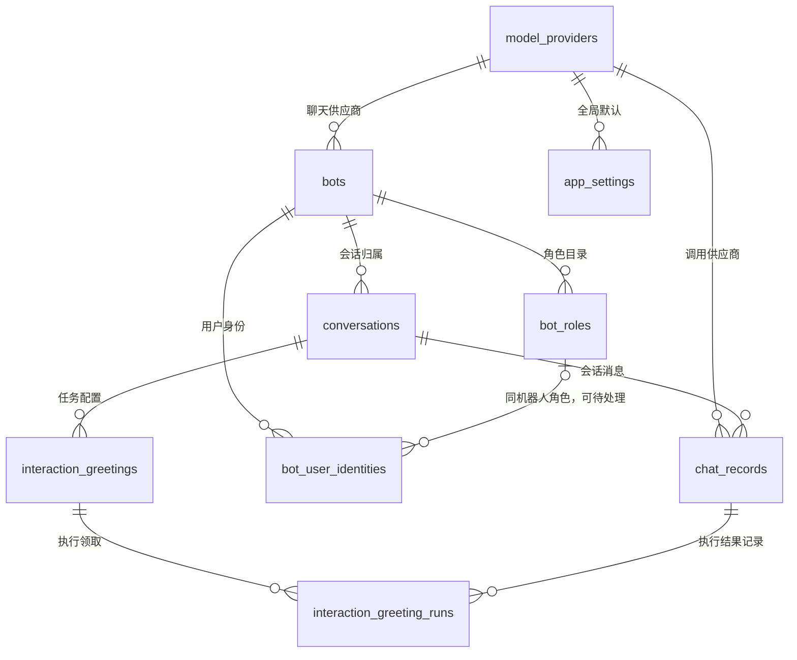

# 数据库表结构与 Agent 开发指南

## 适用范围与事实来源

面向修改 qBot 的开发 Agent，不是机器人的业务提示词。2026-10-26 已只读核对本地项目库：最初基线版本为 `0015_bot_roles`，当时共 10 张业务表和 1 张 Alembic 版本表。当前已升级至 `0018_schedule_timing`，后续新增表和字段见本文扩展说明。字段、空值属性、主键、索引与外键来自实际数据库元数据；业务含义核对 `qbot/storage.py` 及相关调用方。本次未运行测试或真实平台调用，也未重新执行已完成的迁移。

部署到其他环境时先执行 `python -m alembic current` 并与 `migrations/versions/` 核对，不能把本地已升级视为所有环境已升级。结构变更以新增手写 Alembic 迁移为准；已执行的版本和快照不可改写。迁移操作见 [数据库迁移](database-migrations.md)，流程语义见 [存储与记录](storage.md)。

## Agent 先读这些规则

1. 所有机器人业务先限定 `bot_id`。同一个 OpenID 在不同机器人下不自动合并；群聊历史再按群和用户隔离。查询及更新都必须验证目标归属。
2. 数据访问集中在 `Store`，异步入口调用 `await store.call(...)`。不要在异步接口直接执行同步 SQL，也不要只改数据库绕过绑定、凭证、限流和事务校验。
3. MySQL 5.6 使用 InnoDB / utf8mb4；OpenID、编号等部分列使用 ascii_bin。JSON 使用 TEXT/MEDIUMTEXT 序列化，不是 MySQL 原生 JSON 类型；约束依赖服务端校验，不依赖 CHECK。
4. 时间戳按 UTC 保存，代码使用无时区 UTC datetime；界面与定时任务换算 Asia/Shanghai。`local_date`、`start_time` 是任务本地日期/时刻，不可按 UTC 直接理解。
5. 不读取、打印或提交凭证内容；密钥密文也不返回前端。不要把真实用户、消息内容、音频或会话 Token 填进示例文档。
6. 数据库记录用于审计和查询，不等于模型上下文。模型历史保存在内存，数据库不自动恢复上下文、队列或补发失败消息。
7. 已有索引、历史字段和外键有兼容用途，不能因“看似重复”直接删除。不要使用 stamp、删表重建或自动迁移掩盖结构问题。

## 功能到表与代码入口

| 要改什么 | 主要表 | 优先代码入口 |
| --- | --- | --- |
| 模型、默认聊天供应商 | model_providers、app_settings | Store.save_provider / set_default / active_provider |
| 机器人凭证、人设、多模态 | bots | Store.save_bot / bot_config；bots.py；multimodal_config.py |
| 当前智能体的角色目录 | bot_roles | Store.list_identity_roles / save_identity_role / delete_identity_role；identity_roles.py |
| 用户称呼、角色识别 | bot_user_identities、bot_roles | Store.bind_identity_id / save_family_binding / record_detail / family_identity |
| 接收对象名称、发送目标 | conversations | Store.bind_user_id / save_contact / send_targets |
| 接收、发送状态、查询统计 | conversations、chat_records | Store.receive / update_record / query_records / token_statistics |
| 定时配置与一次执行 | interaction_greetings、interaction_greeting_runs、chat_records | Store.save_greeting_settings / claim_scheduled_greeting / save_scheduled_content |
| 管理员登录与退出 | admin_sessions | Store.create_admin_session / admin_session_csrf / delete_admin_session；admin.py |
| 结构升级 | alembic_version | migrations/env.py、migrations/versions/ |

## 关系概览

下图为逻辑关系摘要；精确复合键见各表的外键清单。图中未绘制 JSON 内的逻辑引用。



`bot_user_identities` 与 conversations 通过 `(bot_id, user_id)` 逻辑关联，没有会话外键；一份身份可在同机器人同 OpenID 的多个群/私聊中使用，聊天历史仍分开。`admin_sessions`、`alembic_version` 不归属于某个机器人。

## 各表字段与约束

类型、NULL 和索引为核对时的真实结构。编号字段是否 UNSIGNED、时间精度等以类型列为准；数据库默认值需查相应迁移或 SHOW CREATE TABLE。本文不把默认值视为允许调用方省略归属字段的依据。

### `model_providers` — 模型供应商与模型配置

共享供应商配置，不按机器人复制；同一供应商可被多个机器人选择。默认聊天和机器人聊天只允许 chat；image 当前仅保存生成配置。

| 字段 | 数据库类型 | 可空 | 业务含义 |
| --- | --- | --- | --- |
| `id` | `BIGINT(20) UNSIGNED` | 否 | 自增主键（app_settings 除外） |
| `name` | `VARCHAR(100) COLLATE utf8mb4_unicode_ci` | 否 | 后台配置名称，全局唯一 |
| `api_type` | `VARCHAR(32) CHARACTER SET ascii COLLATE ascii_bin` | 否 | 接口协议：deepseek / openai_compatible；不等于模型用途 |
| `base_url` | `VARCHAR(2048) COLLATE utf8mb4_unicode_ci` | 否 | HTTPS 服务地址 |
| `model_name` | `VARCHAR(200) COLLATE utf8mb4_unicode_ci` | 否 | 上游模型名称 |
| `api_key_encrypted` | `TEXT COLLATE utf8mb4_unicode_ci` | 是 | API Key 密文，可空；仅服务端解密 |
| `enabled` | `TINYINT(3) UNSIGNED` | 否 | 启用标记，0/1 |
| `created_at` | `DATETIME(6)` | 否 | 创建时间，UTC |
| `updated_at` | `DATETIME(6)` | 否 | 最后更新时间，UTC |
| `model_type` | `VARCHAR(16) CHARACTER SET ascii COLLATE ascii_bin` | 否 | 用途：chat / image / asr / tts，默认 chat |
| `supports_images` | `TINYINT(3) UNSIGNED` | 否 | 聊天模型是否声明支持图片输入，0/1 |

主键：`(id)`。

| 索引名 | 列（顺序敏感） | 类型 |
| --- | --- | --- |
| `uq_model_providers_name` | `name` | 唯一 |

无数据库外键。

维护要点：多模态供应商 ID 还可能被 bots.multimodal、任务 delivery 引用，这些是 JSON 逻辑引用，没有数据库外键。停用或修改类型必须沿用 Store.save_provider 的引用检查。密钥留空保留、更换域名校验等以后台保存逻辑为准。

### `app_settings` — 全局设置与共享锁

当前应用使用 id=1 的单例行，不要插入多份全局设置。

| 字段 | 数据库类型 | 可空 | 业务含义 |
| --- | --- | --- | --- |
| `id` | `TINYINT(3) UNSIGNED` | 否 | 固定单例键 1，不自增 |
| `default_provider_id` | `BIGINT(20) UNSIGNED` | 是 | 默认聊天供应商；NULL 表示未选择 |
| `updated_at` | `DATETIME(6)` | 否 | 最后更新时间，UTC |
| `qq_app_id` | `VARCHAR(64) COLLATE utf8mb4_unicode_ci` | 是 | 旧单机器人 AppID，仅兼容保留 |
| `qq_app_secret_encrypted` | `TEXT COLLATE utf8mb4_unicode_ci` | 是 | 旧单机器人密文，仅兼容保留 |
| `qq_transport` | `VARCHAR(16) COLLATE utf8mb4_unicode_ci` | 否 | 旧单机器人接入方式，仅兼容保留 |

主键：`(id)`。

| 索引名 | 列（顺序敏感） | 类型 |
| --- | --- | --- |
| `idx_settings_provider` | `default_provider_id` | 普通 |

- `fk_settings_provider`：`(default_provider_id)` → `model_providers(id)`。

维护要点：当前运行 QQ 配置来源是 bots。供应商、默认项及机器人相关写操作使用该行锁协调，管理员会话创建和任务配置也使用此锁；扩展事务时维持一致锁顺序。后台无默认供应商时不会自动回退环境模型凭证。

### `bots` — 智能体运行配置

每条记录代表一个独立 QQ 机器人及其人设、运行配置；本地备注名不改变官方昵称。

| 字段 | 数据库类型 | 可空 | 业务含义 |
| --- | --- | --- | --- |
| `id` | `BIGINT(20) UNSIGNED` | 否 | 自增主键（app_settings 除外） |
| `name` | `VARCHAR(100) COLLATE utf8mb4_unicode_ci` | 否 | 本地备注名 |
| `app_id` | `VARCHAR(64) CHARACTER SET ascii COLLATE ascii_bin` | 是 | QQ AppID，可空且唯一 |
| `app_secret_encrypted` | `TEXT COLLATE utf8mb4_unicode_ci` | 是 | QQ AppSecret 密文，可空 |
| `transport` | `VARCHAR(16) CHARACTER SET ascii COLLATE ascii_bin` | 否 | websocket / webhook |
| `provider_id` | `BIGINT(20) UNSIGNED` | 是 | 聊天供应商，NULL 跟随 app_settings.default_provider_id |
| `system_prompt` | `TEXT COLLATE utf8mb4_unicode_ci` | 是 | 专属系统人设，空值/空字符串使用默认 system.txt |
| `enabled` | `TINYINT(3) UNSIGNED` | 否 | 启用标记，0/1 |
| `created_at` | `DATETIME(6)` | 否 | 创建时间，UTC |
| `updated_at` | `DATETIME(6)` | 否 | 最后更新时间，UTC |
| `multimodal` | `TEXT COLLATE utf8mb4_unicode_ci` | 是 | TEXT JSON；图片、ASR、TTS及自动回复方式 |

主键：`(id)`。

| 索引名 | 列（顺序敏感） | 类型 |
| --- | --- | --- |
| `fk_bot_provider` | `provider_id` | 普通 |
| `uq_bots_app_id` | `app_id` | 唯一 |

- `fk_bot_provider`：`(provider_id)` → `model_providers(id)`。

维护要点：多模态键包括 images、gifs、asr、vision_provider_id、asr_provider_id、tts_provider_id、voice、private_reply、group_reply，校验见 MultimodalConfig。保存机器人配置由运行管理器重载对应机器人；直接 UPDATE 不会自动重载内存实例。新增机器人不会自动获得其他智能体的专属角色。

### `bot_roles` — 每个智能体的角色目录

仅定义角色，不绑定 QQ 用户，也不授予任何管理员权限。运行时不再读取旧 config/identity_roles.json。

| 字段 | 数据库类型 | 可空 | 业务含义 |
| --- | --- | --- | --- |
| `id` | `BIGINT(20) UNSIGNED` | 否 | 自增主键（app_settings 除外） |
| `bot_id` | `BIGINT(20) UNSIGNED` | 否 | 所属机器人，关联 bots.id；业务隔离边界 |
| `role_key` | `VARCHAR(16) CHARACTER SET ascii COLLATE ascii_bin` | 否 | 机器人内唯一的稳定编号；1～16位小写字母/数字/下划线，字母开头 |
| `label` | `VARCHAR(100) COLLATE utf8mb4_unicode_ci` | 否 | 后台显示名及模型角色名称 |
| `relationship` | `VARCHAR(500) COLLATE utf8mb4_unicode_ci` | 否 | 该角色与当前智能体的关系说明 |
| `member_name` | `VARCHAR(100) COLLATE utf8mb4_unicode_ci` | 否 | 可选预设称呼；空字符串表示绑定时可自由填写姓名 |

主键：`(id)`。

| 索引名 | 列（顺序敏感） | 类型 |
| --- | --- | --- |
| `uq_bot_role_id` | `bot_id, id` | 唯一 |
| `uq_bot_role_key` | `bot_id, role_key` | 唯一 |

- `fk_role_bot`：`(bot_id)` → `bots(id)`。

维护要点：角色编号创建后不可修改。label/relationship 修改在下一次模型请求生效；有用户绑定时禁止删除，预设称呼不能改为与绑定姓名冲突的值。角色 CRUD 与用户绑定共用 bots 行锁，防止并发删除和绑定交错。同一 role_key 在不同机器人下可以有不同含义。

### `bot_user_identities` — 用户在智能体下的身份

主键 (bot_id,user_id)：一个用户在一个机器人下只有一个身份，同角色可以绑定多个用户。

| 字段 | 数据库类型 | 可空 | 业务含义 |
| --- | --- | --- | --- |
| `bot_id` | `BIGINT(20) UNSIGNED` | 否 | 所属机器人，关联 bots.id；业务隔离边界 |
| `user_id` | `VARCHAR(256) CHARACTER SET ascii COLLATE ascii_bin` | 否 | 平台返回的真实用户 OpenID，不是 QQ 号码 |
| `member_name` | `VARCHAR(100) COLLATE utf8mb4_unicode_ci` | 否 | 绑定用户的称呼 |
| `family_role` | `VARCHAR(16) CHARACTER SET ascii COLLATE ascii_bin` | 否 | 兼容 API 的角色编号，须与关联角色 role_key 一致；不是固定枚举 |
| `qq_number_note` | `VARCHAR(20) CHARACTER SET ascii COLLATE ascii_bin` | 是 | QQ 号码备注，不用于鉴权或跨 OpenID 合并 |
| `role_id` | `BIGINT(20) UNSIGNED` | 是 | 角色 ID，可空；NULL 表示迁移后待处理旧绑定 |

主键：`(bot_id, user_id)`。

| 索引名 | 列（顺序敏感） | 类型 |
| --- | --- | --- |
| `ix_identity_role` | `bot_id, role_id` | 普通 |

- `fk_identity_bot`：`(bot_id)` → `bots(id)`。
- `fk_identity_role`：`(bot_id, role_id)` → `bot_roles(bot_id, id)`。

维护要点：复合外键 (bot_id,role_id) → bot_roles(bot_id,id) 禁止跨机器人关联。模型仅使用 role_id、role_key、预设称呼校验成功后的身份。旧绑定不匹配时保留原字段、role_id=NULL，不能靠之后新增同名角色自动认领，须管理员明确重新绑定。绑定只能使用该机器人已经收到消息的 QQ OpenID；不要靠昵称、自称或 QQ 备注猜测。

### `conversations` — 会话范围与接收人通讯录

身份、接收人名称、聊天历史是不同概念；本表负责后两者的范围和通讯录。

| 字段 | 数据库类型 | 可空 | 业务含义 |
| --- | --- | --- | --- |
| `id` | `BIGINT(20) UNSIGNED` | 否 | 自增主键（app_settings 除外） |
| `source` | `VARCHAR(16) CHARACTER SET ascii COLLATE ascii_bin` | 否 | qq_group / qq_c2c / local |
| `group_id` | `VARCHAR(191) CHARACTER SET ascii COLLATE ascii_bin` | 否 | 群 OpenID；私聊为 c2c: 加用户 OpenID 的 SHA-256，非空 |
| `user_id` | `VARCHAR(256) CHARACTER SET ascii COLLATE ascii_bin` | 否 | 会话中的发送者 OpenID；本地聊天为本地用户标识 |
| `created_at` | `DATETIME(6)` | 否 | 创建时间，UTC |
| `last_active_at` | `DATETIME(6)` | 否 | 最后接收活动时间，UTC |
| `bot_id` | `BIGINT(20) UNSIGNED` | 否 | 所属机器人，关联 bots.id；业务隔离边界 |
| `member_name` | `VARCHAR(100) COLLATE utf8mb4_unicode_ci` | 是 | 旧会话级身份字段，仅兼容核对，非当前身份来源 |
| `family_role` | `VARCHAR(16) CHARACTER SET ascii COLLATE ascii_bin` | 是 | 旧会话级角色字段，仅兼容核对 |
| `qq_number_note` | `VARCHAR(20) CHARACTER SET ascii COLLATE ascii_bin` | 是 | 旧会话级 QQ 备注，仅兼容核对 |
| `contact_name` | `VARCHAR(100) COLLATE utf8mb4_unicode_ci` | 是 | 接收人显示名，用于发送目标/定时任务选择 |
| `contact_qq` | `VARCHAR(20) CHARACTER SET ascii COLLATE ascii_bin` | 是 | 接收人的 QQ 备注，不是平台投递标识 |

主键：`(id)`。

| 索引名 | 列（顺序敏感） | 类型 |
| --- | --- | --- |
| `idx_conversation_activity` | `last_active_at, id` | 普通 |
| `idx_conversation_user` | `source, user_id, last_active_at` | 普通 |
| `uq_conversation_bot_scope` | `id, bot_id, source, group_id` | 唯一 |
| `uq_conversation_identity` | `bot_id, source, group_id, user_id` | 唯一 |
| `uq_conversation_scope` | `id, source, group_id` | 唯一 |

- `fk_conversation_bot`：`(bot_id)` → `bots(id)`。

维护要点：唯一键包含 (bot_id,source,group_id,user_id)，不要去掉 bot_id 或把群聊用户合并为一份模型历史。contact_name 不会赋予角色；解除接收人绑定会停用该会话的问候规则，但不删除聊天记录或用户角色。群目标发给整个群，不是该群成员的私信。

### `chat_records` — 消息处理与投递审计

接收时落库，保存处理状态、模型快照、用量和媒体摘要；也用于手动发送和定时任务。

| 字段 | 数据库类型 | 可空 | 业务含义 |
| --- | --- | --- | --- |
| `id` | `BIGINT(20) UNSIGNED` | 否 | 自增主键（app_settings 除外） |
| `conversation_id` | `BIGINT(20) UNSIGNED` | 否 | 所属会话 ID，复合外键进一步约束机器人、来源和群 |
| `source` | `VARCHAR(16) CHARACTER SET ascii COLLATE ascii_bin` | 否 | 冗余来源字段，用于隔离和查询 |
| `group_id` | `VARCHAR(191) CHARACTER SET ascii COLLATE ascii_bin` | 否 | 冗余群/私聊范围，必须与会话一致 |
| `external_message_id` | `VARCHAR(512) CHARACTER SET ascii COLLATE ascii_bin` | 否 | 平台消息 ID 或本地操作幂等键，不全是 QQ 返回值 |
| `record_type` | `VARCHAR(16) CHARACTER SET ascii COLLATE ascii_bin` | 否 | chat / reset；主动与定时发送仍使用 chat |
| `question` | `MEDIUMTEXT COLLATE utf8mb4_unicode_ci` | 否 | 输入文本或后台/定时操作摘要 |
| `answer` | `MEDIUMTEXT COLLATE utf8mb4_unicode_ci` | 是 | 模型回复、主动发送文本或媒体摘要，可空 |
| `status` | `VARCHAR(24) CHARACTER SET ascii COLLATE ascii_bin` | 否 | 处理/投递状态，详见状态说明 |
| `error_message` | `VARCHAR(1000) COLLATE utf8mb4_unicode_ci` | 是 | 适合后台展示的脱敏错误，可空 |
| `provider_id` | `BIGINT(20) UNSIGNED` | 是 | 实际调用的供应商 ID，可空 |
| `provider_name_snapshot` | `VARCHAR(100) COLLATE utf8mb4_unicode_ci` | 是 | 调用时供应商名快照，不随配置重命名 |
| `model_name_snapshot` | `VARCHAR(200) COLLATE utf8mb4_unicode_ci` | 是 | 调用时模型名快照 |
| `message_sent_at` | `DATETIME(6)` | 是 | 上游消息时间，可空，UTC |
| `received_at` | `DATETIME(6)` | 否 | 本项目接收/建立记录时间，UTC |
| `completed_at` | `DATETIME(6)` | 是 | 结束处理时间，可空，UTC |
| `updated_at` | `DATETIME(6)` | 否 | 最后更新时间，UTC |
| `bot_id` | `BIGINT(20) UNSIGNED` | 否 | 所属机器人，关联 bots.id；业务隔离边界 |
| `media_details` | `MEDIUMTEXT COLLATE utf8mb4_unicode_ci` | 是 | MEDIUMTEXT JSON：媒体处理、用量、回退及分段发送诊断 |
| `input_tokens` | `BIGINT(20)` | 是 | 聊天模型输入用量；NULL=未知，不是0 |
| `output_tokens` | `BIGINT(20)` | 是 | 聊天模型输出用量；NULL=未知 |
| `total_tokens` | `BIGINT(20)` | 是 | 聊天模型总用量；缺失时仅在输入输出齐全时相加 |

主键：`(id)`。

| 索引名 | 列（顺序敏感） | 类型 |
| --- | --- | --- |
| `fk_chat_bot_scope` | `conversation_id, bot_id, source, group_id` | 普通 |
| `idx_chat_bot_time` | `bot_id, received_at, id` | 普通 |
| `idx_chat_conversation_scope` | `conversation_id, source, group_id` | 普通 |
| `idx_chat_conversation_time` | `conversation_id, received_at, id` | 普通 |
| `idx_chat_group_time` | `source, group_id, received_at, id` | 普通 |
| `idx_chat_provider` | `provider_id` | 普通 |
| `idx_chat_received` | `received_at, id` | 普通 |
| `idx_chat_status_time` | `status, received_at, id` | 普通 |
| `uq_chat_external_message` | `bot_id, source, group_id, external_message_id` | 唯一 |

- `fk_chat_bot_scope`：`(conversation_id, bot_id, source, group_id)` → `conversations(id, bot_id, source, group_id)`。
- `fk_chat_conversation`：`(conversation_id, source, group_id)` → `conversations(id, source, group_id)`。
- `fk_chat_provider`：`(provider_id)` → `model_providers(id)`。

维护要点：唯一键 uq_chat_external_message=(bot_id,source,group_id,external_message_id) 阻止重复接收。复合会话外键保证范围一致。媒体详情不存原始音频、原图、Base64 或临时签名地址；文件名、摘要与状态可以保存。视觉/ASR/TTS 不混入聊天 token 字段。发送前可能已保存 answer，因此 answer 非空不等于送达。

### `interaction_greetings` — 定时任务规则

表名沿用早期互动问候；当前是定时任务配置，不要从表名推断必须收到用户消息才执行。

| 字段 | 数据库类型 | 可空 | 业务含义 |
| --- | --- | --- | --- |
| `id` | `BIGINT(20) UNSIGNED` | 否 | 自增主键（app_settings 除外） |
| `bot_id` | `BIGINT(20) UNSIGNED` | 否 | 所属机器人，关联 bots.id；业务隔离边界 |
| `conversation_id` | `BIGINT(20) UNSIGNED` | 否 | 目标会话 ID，保存时校验与 bot_id 一致 |
| `slot` | `VARCHAR(8) CHARACTER SET ascii COLLATE ascii_bin` | 否 | morning / noon / evening |
| `enabled` | `TINYINT(3) UNSIGNED` | 否 | 启用标记，0/1 |
| `start_time` | `CHAR(5) CHARACTER SET ascii` | 否 | 北京时间 HH:MM，自动执行的发送起始时刻 |
| `end_time` | `CHAR(5) CHARACTER SET ascii` | 否 | 旧窗口结束字段，兼容保留；当前不参与调度 |
| `weekdays` | `VARCHAR(13) CHARACTER SET ascii` | 否 | 星期逗号列表，例如 1,2,3,4,5；周一=1 |
| `content` | `VARCHAR(200) COLLATE utf8mb4_unicode_ci` | 否 | 固定文案/草稿，最多200字 |
| `delivery` | `TEXT COLLATE utf8mb4_unicode_ci` | 是 | TEXT JSON：投递方式、workflow、TTS 等配置 |
| `image_data` | `MEDIUMBLOB` | 是 | 上传到任务的持久图片二进制，可空；不是聊天媒体缓存 |
| `image_filename` | `VARCHAR(150) COLLATE utf8mb4_unicode_ci` | 是 | 任务图片文件名，可空 |

主键：`(id)`。

| 索引名 | 列（顺序敏感） | 类型 |
| --- | --- | --- |
| `fk_greeting_conversation` | `conversation_id` | 普通 |
| `uq_greeting_bot` | `id, bot_id` | 唯一 |
| `uq_greeting_scope` | `bot_id, conversation_id, task_key, slot` | 唯一，0017 扩展 |

- `fk_greeting_bot`：`(bot_id)` → `bots(id)`。
- `fk_greeting_conversation`：`(conversation_id)` → `conversations(id)`。

维护要点：一个机器人一个会话每个 slot 只有一条配置。conversation_id 外键本身不校验 bot_id，必须复用服务端归属校验。delivery.workflow 包含 version、content_source、image_source、output、library_id；TTS 引用无数据库外键。素材库随机图从文件读取，不复制到每条任务；上传任务图需要持久化以供重复执行。

### `interaction_greeting_runs` — 一次领取与执行历史

规则领取和独立 chat_records 记录在同一事务中建立；该表是幂等账本，不是可随意清理的缓存。

| 字段 | 数据库类型 | 可空 | 业务含义 |
| --- | --- | --- | --- |
| `id` | `BIGINT(20) UNSIGNED` | 否 | 自增主键（app_settings 除外） |
| `bot_id` | `BIGINT(20) UNSIGNED` | 否 | 所属机器人，关联 bots.id；业务隔离边界 |
| `greeting_id` | `BIGINT(20) UNSIGNED` | 否 | 任务规则 ID，与 bot_id 组合引用规则 |
| `local_date` | `DATE` | 是 | 自动执行为北京时间日期；手动执行为 NULL |
| `record_id` | `BIGINT(20) UNSIGNED` | 否 | 对应 chat_records.id；最终成功/失败状态从该记录读取 |
| `content` | `VARCHAR(200) COLLATE utf8mb4_unicode_ci` | 否 | 本次实际文案；AI 生成前可为空字符串 |
| `created_at` | `DATETIME(6)` | 否 | 创建时间，UTC |

主键：`(id)`。

| 索引名 | 列（顺序敏感） | 类型 |
| --- | --- | --- |
| `fk_greeting_run_record` | `record_id` | 普通 |
| `fk_greeting_run_rule` | `greeting_id, bot_id` | 普通 |
| `uq_greeting_day` | `bot_id, greeting_id, local_date` | 唯一 |

- `fk_greeting_run_record`：`(record_id)` → `chat_records(id)`。
- `fk_greeting_run_rule`：`(greeting_id, bot_id)` → `interaction_greetings(id, bot_id)`。

维护要点：唯一键 uq_greeting_day=(bot_id,greeting_id,local_date) 保障自动任务每天最多领取一次。MySQL 唯一键允许多个 NULL，因此手动每次执行可建立新记录。领取后失败仍占自动当天次数，崩溃或送达未知不自动重发；不要删除领取记录“修复失败”。record_id 的外键仅引用消息 ID，机器人一致性由事务代码保证。

### `admin_sessions` — 后台登录会话

不是 QQ 用户会话，也不是聊天上下文；不关联 bot_id。

| 字段 | 数据库类型 | 可空 | 业务含义 |
| --- | --- | --- | --- |
| `token_hash` | `CHAR(64) CHARACTER SET ascii COLLATE ascii_bin` | 否 | 会话 Token 的 SHA-256 摘要，主键；不存 Cookie 原 Token |
| `csrf_token` | `VARCHAR(64) CHARACTER SET ascii COLLATE ascii_bin` | 否 | 写接口 CSRF 校验值，视为敏感字段 |
| `auth_version` | `CHAR(64) CHARACTER SET ascii COLLATE ascii_bin` | 否 | 账号、密码哈希及签名配置关联的指纹，配置变化令旧会话失效 |
| `created_at` | `DATETIME` | 否 | 创建时间，UTC |
| `expires_at` | `DATETIME` | 否 | 固定 UTC 到期时间，不因重启延长 |

主键：`(token_hash)`。

| 索引名 | 列（顺序敏感） | 类型 |
| --- | --- | --- |
| `ix_admin_sessions_expires_at` | `expires_at` | 普通 |

无数据库外键。

维护要点：当前有效期固定1小时，创建时清理过期项并最多保留100个有效会话。Cookie 带签名，HttpOnly/SameSite，查询需校验摘要、配置指纹和到期时间。不要 SELECT * 导出登录会话，不把 CSRF 或会话标识写入日志。

### `alembic_version` — 迁移状态

由 Alembic 管理，不是业务配置表。

| 字段 | 数据库类型 | 可空 | 业务含义 |
| --- | --- | --- | --- |
| `version_num` | `VARCHAR(32) COLLATE utf8mb4_unicode_ci` | 否 | 已应用的迁移 revision；当前本地为 0018_schedule_timing |

主键：`(version_num)`。

无数据库外键。

维护要点：不要手工 UPDATE 或 stamp 到新版本跳过未执行迁移。应用启动仅反射并检查结构，不执行 schema 升级。

## 状态、幂等与事务边界

| 状态 | 含义 | Agent 注意 |
| --- | --- | --- |
| pending | 已接收，待处理 | 不表示队列重启后可恢复 |
| processing | 正在处理或投递 | 进程异常可能遗留，不能仅凭状态重发 |
| replied | 发送回调成功，QQ 场景为平台确认 | 不代表用户已读 |
| rejected | 输入或处理条件拒绝 | 错误原因以具体入口为准 |
| expired | 超过处理有效期 | 不应重新使用过期消息 ID |
| model_failed | 模型或生成阶段失败 | 可能已产生费用，不可推断零用量 |
| send_failed | 发送准备/平台拒绝等失败 | 结合脱敏错误与 media_details 判断阶段 |
| delivery_unknown | 投递结果无法确认 | 不自动重发，不把未知当作失败 |

幂等键包括平台真实 ID、后台 `admin-send:<request_id>`、自动 `scheduled:<greeting_id>:<日期>`、手动 `scheduled-manual:<greeting_id>:<UUID>`。这些字符串由代码生成；不要伪造旧 QQ msg_id 绕过主动发送约束。

主要事务：

- `receive` 同时查重、建立/更新会话并写记录，依赖数据库唯一键处理并发。
- 角色 CRUD 和身份绑定先锁所属 `bots` 行；删除角色与绑定写入不能各自分离提交。
- `claim_scheduled_greeting` 锁任务并复核条件，创建 processing 消息和执行领取；生成文案由 `save_scheduled_content` 同时更新执行历史和消息。
- 外部模型/QQ 网络调用不应放进长时间数据库事务；发送前落库，发送后更新结果。不要因“已写 answer”宣称已发出。

## 只读排查示例

下例使用 SQLAlchemy `text()` 绑定参数（不是拼接字符串）；在现有连接 `conn` 中执行，只查询必要字段。示例返回值含业务信息，排障时也不要全量写入日志。

```python
# 当前迁移版本
conn.execute(text("SELECT version_num FROM alembic_version"))

# 指定智能体的角色定义
conn.execute(text("""
    SELECT id, role_key, label, member_name, relationship
    FROM bot_roles WHERE bot_id=:bot_id ORDER BY id
"""), {"bot_id": selected_bot_id})

# 待重新绑定的身份数量，不输出真实用户标识
conn.execute(text("""
    SELECT COUNT(*) FROM bot_user_identities
    WHERE bot_id=:bot_id AND role_id IS NULL
"""), {"bot_id": selected_bot_id})

# 一个智能体最近消息的状态，不读取聊天内容、凭证或媒体
conn.execute(text("""
    SELECT id, conversation_id, status, received_at
    FROM chat_records WHERE bot_id=:bot_id
    ORDER BY received_at DESC, id DESC LIMIT 20
"""), {"bot_id": selected_bot_id})
```

进一步按真实用户定位时，以 conversations.user_id 或 bot_user_identities.user_id 为准，并同时限定 bot_id。不能把 contact_qq/qq_number_note 当 OpenID，也不能读取旧 conversations.family_role 后覆盖独立身份表。

## 后续维护要求

新增字段、表、索引、约束或字段语义后，同步本文件的版本基线、关系图、字段说明及代码入口；保持 [storage.md](storage.md) 侧重运行流程，本文件侧重数据库事实，避免两份完整字段清单相互冲突。数据库列改动新增手写迁移，业务行为变化即使无迁移也需更新含义说明。

角色迁移快照 `migrations/snapshots/0015_identity_roles.json` 只供一次性升级导入，不是运行配置。新增角色通过后台管理；不要修改已执行快照期待数据库自动更新。

验证边界：本次核对迁移版本、11张表全部字段、主键、索引与外键，并对照数据访问代码；未验证真实消息、定时发送、登录或模型端到端流程。


### `bot_contact_notes` — 用户与群备注（0016，本地已核对）

| 字段 | 类型 | 可空 | 用途 |
| --- | --- | --- | --- |
| bot_id | BIGINT UNSIGNED | 否 | 机器人归属，外键 bots(id) |
| target_type | VARCHAR(8) ascii_bin | 否 | user / group，服务端写入固定值 |
| openid | VARCHAR(256) ascii_bin | 否 | 用户或群 OpenID |
| name | VARCHAR(100) utf8mb4 | 否 | 后台备注名 |
| qq_number | VARCHAR(20) ascii_bin | 是 | 用户 QQ 号备注，群为 NULL |
| updated_at | DATETIME(6) | 否 | 最后更新 UTC 时间 |

主键 `(bot_id, target_type, openid)`，外键 `fk_contact_note_bot`。不关联某个 conversation_id；用户备注与群备注、不同机器人分别隔离。旧 conversations.contact_name/contact_qq 保留为定时任务兼容字段，由 save_contact 同步；新 QQ 会话继承用户备注。迁移仅导入无冲突用户备注，有冲突的旧值不覆盖。删除用户备注同步清除同 OpenID 会话的兼容字段并停用其任务，清除群备注不影响任务。不得根据 QQ 号或备注名合并 OpenID。

2026-10-26 后续核对：本地版本现为 `0016_contact_notes`，新增表主键和外键已核对，早前 0015 的全库快照说明保留为历史基线。当前新增表 3 条用户备注，群备注尚未设置。

## 独立任务扩展（0017）

`interaction_greetings.task_key` 为 ASCII VARCHAR(36)、非空默认空字符串；旧早午晚配置使用空值，新任务使用 UUID。`task_name` 为 VARCHAR(100)、非空默认空字符串，新任务必填。`uq_greeting_scope` 更新为 `(bot_id, conversation_id, task_key, slot)`。独立任务在服务端限定一个时段，0018 起可修改时段并保留原 ID；修改发送时间不受此限制。旧主键、图片、配置和执行记录不回填或删除，`interaction_greeting_runs` 的每日唯一索引不变。读写任务时必须同时限定 bot_id、conversation_id、task_key；不能再只按 slot 定位。

0017 已在本地执行，原 6 条任务、11 条执行记录字段未变，已核对新唯一索引；未新增测试任务或真实发送。

## 定时触发语义（0018）

interaction_greetings 新增 schedule_updated_at，DATETIME(6) 非空、UTC，应用在每次保存时更新，不依赖数据库默认值。自动任务仅在北京时间 start_time 对应分钟领取，且保存时刻必须早于该分钟开始；过期不补发，手动执行不受此条件限制。slot 新增 other（无需扩列），新独立任务可按 task_key 修改 slot，仍保留 greeting_id 和每日去重记录。

0018 已在本地执行并核对：8 条任务、14 条执行记录既有字段保持不变，保存时刻非空。

## 0019_user_nickname：平台昵称

conversations 新增可空 `platform_nickname VARCHAR(256)`（utf8mb4），独立于管理员 contact_name/用户备注与 bot_user_identities。Store.receive 从平台事件接收非空昵称，在机器人行锁下同步同 bot_id/user_id 的 QQ 会话；过滤不可打印字符并限制长度。读取批量选择最近会话的有效昵称；空推送不清空，不推断旧昵称，不影响任务资格或模型身份。

语音文本沿用 chat_records.media_details：attachments[].transcript 为 ASR 转写，tts_text 为合成正文；手动 TTS 同时保存 answer，question 中含文本快照参与原幂等比较。音频文件不入库；旧记录不补造文本。新增迁移须显式执行，应用不自动迁移。

## 0020 主人绑定（已编写，待验证）

bot_user_identities 新增可空 owner_slot TINYINT 与 owner_selected_at DATETIME(6)。应用只写 NULL（普通身份）或 1（主人），唯一索引 uq_identity_owner(bot_id, owner_slot) 利用 MySQL 允许多个 NULL 确保同机器人只有一位主人。选择、切换、解绑和身份编辑共用机器人行锁；选择时间用于排除认主前的同群发言。旧身份初始化为非主人，不根据角色名称自动认领。

2026-10-28：认主相关代码已编写，Python/JavaScript 语法与差异静态检查通过；未运行测试、浏览器或真实模型验收。

## 0021 定时模板（已编写，待验证）

scheduled_templates 是管理员全局模板表，不保存任何会话身份。id BIGINT UNSIGNED 主键，name VARCHAR(100)，config MEDIUMTEXT 保存文案、工作流、提示词、TTS供应商与音色，image_data MEDIUMBLOB、image_filename VARCHAR(150) 可空，created_at/updated_at DATETIME(6) UTC。任务套用后保存独立快照，无模板外键；删除模板不删除任务。

2026-10-28：完成 Python AST、JavaScript 语法、HTML ID/脚本资源及差异静态检查；未运行测试、浏览器、数据库迁移或模型/TTS/QQ 调用。需显式升级数据库、重启后端并刷新后台后使用。
