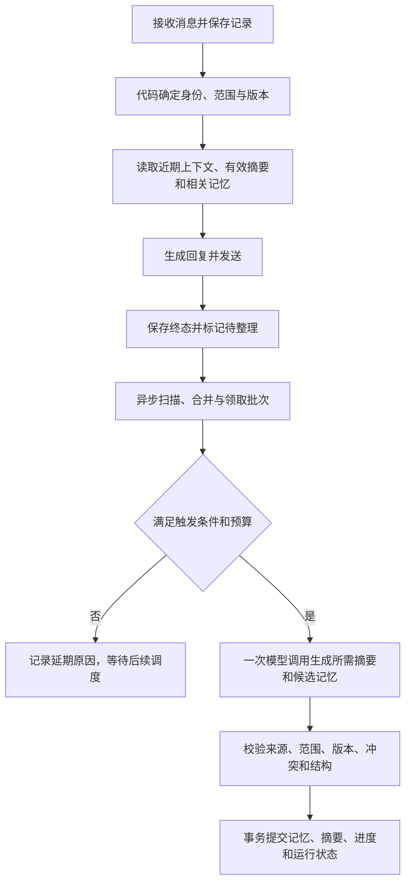

# 记忆系统开发方案

状态：**首版代码已编写，迁移未执行，运行效果待验收。以下实现说明优先于后文初始方案。**

## 2026-10-30 首版实现（待运行验收）

已编写后台模式的持久化记忆、显式命令、异步整理、预算预留与管理页面。新增迁移 `0024_memory`，接续工作区的 `0023_voice_calls`；本轮不执行数据库迁移、重启服务或真实模型调用。

为可靠记录逐条处理资格、接收时主人版本、失败区间和分段位置，增加 `memory_sources` 待处理表，与聊天接收同事务写入，替代仅靠最大记录 ID 推进游标的方案。全局预算使用现有 app_settings 行锁及运行记录汇总，避免再新增调度服务。默认关闭记忆，后台明确启用；整理模型单独选择，无备用模型切换。

首版显式操作采用确定性命令及后台表单，不使用聊天模型猜测删除对象。未知调用只能由管理员明确重试，重新占用预算。原方案中的验收项在运行验证前保持未勾选。

### 使用步骤

1. 停止服务并备份项目库，显式执行 `.\.venv\Scripts\python -m alembic upgrade head`，确认升级至 `0024_memory` 后重启、刷新后台。此命令也会应用尚未执行的前置迁移，执行前审阅相关说明。
2. 在“记忆管理”选择机器人，开启持久化记忆。默认关闭，不替用户选择供应商，不自动回填旧记录。
3. 需要自动整理时，单独选择已启用的聊天模型，确认模型采用字节级分词且支持输出上限，再勾选自动整理。记忆模型不使用聊天备用模型，不自动重试。
4. 保存设置后下次对话生效，无需重载机器人。修改设置会取消旧候选任务、重新开始近期上下文并保留长期记忆；建议先处理重要的积压批次。
5. 按具体会话新增、编辑、确认待定条目或遗忘。查看来源按钮打开既有聊天记录详情。会话下拉目前显示最近300个 QQ 会话，条目每页20条，运行记录显示最近30次。

| 聊天命令 | 行为 |
| --- | --- |
| `/memory`、`你记得我什么` | 查看本人当前范围最近10条有效记忆 |
| `/remember 内容`、`记住：内容` | 无模型调用，立即持久化1～600字原文笔记 |
| `/memory-edit 编号 新内容` | 修改本人可访问的条目，重新开始相关近期上下文 |
| `/forget 编号` | 清除对应事实及同键历史版本正文；清理摘要与候选并推进恢复边界 |
| `/remember-group 内容` | 仅当前群真实主人可用，明确创建当前群共享笔记 |
| `/reset` | 清当前会话近期上下文和摘要，保留长期记忆 |

“记住这个”等含糊表达会返回明确操作说明，不猜测其指代。显式操作不走整理模型，也不自动生成语音。未开启记忆时命令明确提示不可用；`/reset` 仍可用。

### 接入与实际限制

| 代码入口 | 职责 |
| --- | --- |
| `qbot/memory_config.py` | 配置与候选结构校验、显式命令、字节预算 |
| `qbot/memory_store.py` | 设置、条目、遗忘、身份失效、上下文恢复及检索 |
| `qbot/memory_jobs.py` | 逐条来源、分段、预算、批次、结算、失败恢复和回填 |
| `qbot/memory.py` | 应用级异步 worker，模型调用上限30秒、输出800 token、重试0次 |
| `qbot/memory_routes.py` | 管理员接口，前缀 `/api/admin/memory/{bot_id}` |
| `qbot/prompts/memory.txt`、`memory_use.txt` | 独立的整理与记忆使用提示词 |
| `qbot/static/memory.js`、`memory.css` | 记忆管理页面 |

- 内存通知使用一个可合并的 `asyncio.Event`，数据库 `memory_sources` 是持久待处理账本；每60秒扫描，无消息不调用。只有一个 worker，不逐消息创建任务。
- 群普通成员不自动提取长期记忆；达到批量或长度条件时只生成本人摘要。主人发言同时符合相关性和来源要求后才生成共享条目。
- 同一次调用合并摘要与事实提取；超长原文按字符位置分段，剩余部分继续排队并服从冷却。失败或未知来源独立阻塞，新消息不被最大ID游标误跳过。
- 成本采用 UTF-8 字节上界加256 token封装余量预留，仅用于经管理员确认兼容的模型。它不是实际 token 计量或人民币预算；实际用量由供应商返回，缺失保留未知和预留占用。每次完整输入预留上限6000，输出上限800；全局60次/180000、单机器人默认20次/60000每日限制同时生效。
- 回复恢复最近24小时最多10轮成功回复，原文整体最多9000 UTF-8字节；摘要、长期条目及主人短期参考合计最多4500 UTF-8字节。首版以字节上限实现，不声称精确对应初稿中的1500 token。近期原文可与摘要重叠，以保留刚刚交流的准确措辞。
- 历史恢复保留已存储的语音转写和视觉说明，但长期提取不重新识别图片、不把视觉推断作为用户事实。未保存的原始媒体仍无法复看。
- 主人版本按机器人递增；群共享遗忘通过递增该群所有已存在会话的代次实现失效，无单独群版本表。身份角色编辑首版保守清理整个机器人近期上下文；解绑一般成员只清其会话。主人切换和取消使旧要求失效，共享事实降回原个人范围。
- 在途回复与管理员的记忆/身份写操作按机器人异步锁串行；管理操作可能等待当前回复完成，返回成功后不会继续发送旧版本回复。数据库事务不会跨模型网络调用持锁。
- “请求整理”仅请求后台处理已有来源，不能绕过冷却、模型开关或预算。历史回填最多1000条/API、100条/页面；群历史不追认为接收时主人发言，因此只能做个人摘要，私聊历史可提取事实。重置或遗忘前的历史不得回填。
- 模型明确更正可以替代自动条目，涉及管理员/用户显式条目时进入待确认。自动提取不解除遗忘墓碑；用户/管理员明确重新提供相同内容或事实键时可解除。
- 不接入网页语音通话、本地 chat 或定时问候；不引入新依赖、新服务或环境变量。没有执行任何付费调用、数据库迁移或浏览器验证。

静态核对：本轮11个相关Python文件通过AST解析，新增记忆页面及导航脚本通过JavaScript语法检查；后台HTML无重复ID、无缺失静态资源，记忆文档相对链接存在，差异格式检查通过。这些结果不代表数据库兼容、后台交互、模型结构化输出或QQ真实回复已验收。

更新日期：2026-10-28。本文面向项目维护者与开发 Agent，不作为业务提示词。当前运行行为以[智能体链路](agent-flow.md)、[存储与记录](storage.md)及代码为准。

## 1. 目标与已确定方向

在现有 Python + LangChain、单进程、多机器人和 MySQL 架构上增加可持久化、可解释、可纠正的记忆系统，使机器人能够恢复近期对话，并在以后聊天时使用相关事实和偏好。

本轮明确的开发方向：

1. 普通记忆整理异步执行，不在 QQ 回复链路中等待整理模型。
2. 记忆整理调用大模型时必须控制成本，采用增量批处理、独立模型配置、调用次数限制和 token 预算。
3. 群聊默认以后台绑定的主人发言作为主要长期记忆来源，普通成员不默认参与自动长期记忆提取。
4. 继续复用 MySQL、现有聊天记录和供应商管理；第一版不引入 Redis、Celery、向量数据库或额外服务。
5. 2026-10-28 方案阶段只形成开发文档；2026-10-30 首版实现与差异见本文开头，验收进度不提前勾选。

以下数值均为**建议初始值**，不是当前配置，也未经过效果或成本验证。开发时先按这组值实现可配置限制，再依据真实使用数据调整。

## 2. 当前基础与接入范围

| 当前基础 | 已核对的行为 | 设计接入方式 |
| --- | --- | --- |
| `qbot/chat.py` | 内存上下文默认最近 10 轮，闲置 1800 秒过期；发送成功后写入历史 | 增加受限的持久化上下文读取，保持发送状态边界 |
| `qbot/recording.py` | 读取供应商、身份和主人信息；生成结果先入库，发送后更新状态 | 在回复前取得记忆资料，记录终结后标记待整理 |
| `qbot/storage.py` | MySQL 聊天记录；同步事务通过 `Store.call` 异步调用 | 统一承担记忆读写、任务领取、预算和幂等校验 |
| `qbot/server.py` | FastAPI lifespan 管理机器人和定时调度生命周期 | 在后台模式启动一个应用级记忆 worker |
| `qbot/bots.py` | 每个机器人独立队列和聊天实例，保存配置可重载对应实例 | 记忆任务不依赖短命聊天实例，执行前重新校验机器人配置 |
| 主人参考 | 同群、认主之后、近 30 分钟最多 5 条已回复主人发言 | 保留近期参考，新增长期记忆后去重并共用输入预算 |

持久化记忆第一版仅面向启用后台和 MySQL 的 QQ 聊天。无后台模式保持现有内存行为；本地 chat 暂不自动混入 QQ 用户记忆。

QQ 群输入只覆盖平台实际推送并由机器人接收的消息，目前主要是 @ 机器人的消息。不能宣称机器人能整理整群未接收的聊天。

## 3. 三层记忆

| 层次 | 内容 | 持久化与生命周期 |
| --- | --- | --- |
| 近期上下文 | 最近几轮用户原文和确认发送成功的回复 | 复用聊天记录，在当前会话代次和时间窗口内按需恢复 |
| 会话摘要 | 当前话题、必要背景、进度、未解决问题 | 单独保存摘要与已覆盖的记录范围；按上下文长度增量更新 |
| 长期记忆 | 稳定偏好、明确事实、持续目标、重要经历、有效的长期要求 | 保存独立条目、来源、主体、范围、时间与状态 |

长期记忆包含有期限的条目，不额外建立一套临时记忆系统。例如“本周出差”设置到期时间，“喜欢清淡食物”长期保留。“今天有点累”等低价值状态通常只留在近期上下文。

摘要是对原文的压缩，不是新的事实来源。必须区分用户已经决定、机器人只是建议、尚待确认；不能把机器人建议改写为双方约定。

原始聊天记录继续作为审计来源。记忆的删除、过期与聊天记录的保存策略分别处理，见第 10 节。

## 4. 身份、隔离与群聊主人优先

### 4.1 范围必须由代码确定

所有查询、写入、更新、删除和任务幂等都先限定 `bot_id`，再限定来源、群和用户。模型不决定目标机器人、发言人或可访问范围。

| 记忆范围 | 默认来源与使用边界 |
| --- | --- |
| 私聊个人 | 当前机器人与真实发送者的私聊；只在该私聊中使用 |
| 群内个人 | 当前机器人、当前群、当前发送者；只用于同群与该成员的交互 |
| 群共享 | 当前群内主人公开表达且适合群内复用的事实或要求；同群可使用，必须注明事实主体和发布者 |
| 后台配置 | 人设、角色、主人身份及权限；读取当前配置，不由记忆提取改写 |

主人公开说“我喜欢清淡食物”，可形成主体为主人的群内事实，不能据此认为其他成员也喜欢清淡食物。对本人临时请求不自动扩大为全群规则；无法确定是否适合共享的条目保留在群内个人范围。

不跨机器人、跨群或将私聊记忆带入群聊。QQ 私聊与群聊用户 OpenID 不保证相同，不通过昵称、姓名、备注或 QQ 号自动关联；第一版不新增跨场景身份映射。

### 4.2 默认采集策略

默认策略名称建议为 `owner_first`，具体含义如下：

| 场景 | 近期上下文与摘要 | 自动长期记忆 | 显式“记住” |
| --- | --- | --- | --- |
| 私聊用户 | 保留本人上下文，按需生成摘要 | 提取本人明确表达的有价值内容 | 保存到本人私聊范围 |
| 群内主人 | 保留本人上下文，优先整理 | 开启；区分群内个人事实和可共享事实/要求 | 根据明确语义保存到本人或当前群范围 |
| 群内普通成员 | 保留本人上下文，摘要仅在长度需要时整理 | 默认关闭 | 仅允许本人群内个人范围，不改写主人或群共享记忆 |
| 群内未绑定主人 | 保留各成员上下文 | 默认关闭群自动长期记忆 | 各成员仍可保存本人范围的显式记忆 |

第一版不自动汇总所有群成员为一份全群摘要。主人的群共享条目可以跨当前群的成员会话检索，但不合并他们的近期聊天历史。

“主人优先”作用于采集资格、任务调度和相关条目的排序，不代表主人所有话都永久保存，也不代表每轮回答都必须插入主人信息。普通用户对自身事实的更正不能被主人的不同说法覆盖。

主人身份只读取后台绑定及有效角色关联，不接受自称、昵称、转述或模型判断。记录接收时保存可信的主人绑定版本；异步提取前和提交前再次核对，不能把认主前的普通发言追认为主人要求。

### 4.3 主人切换与身份变化

主人绑定版本使用按机器人单调递增的整数，与设置、取消或重新绑定主人的操作同事务更新。现有 `owner_selected_at` 继续提供时间信息，但不能单独作为版本，因为同一秒内可能发生多次切换。

- 主人要求携带发布者和绑定版本，切换或取消主人后立即停止参与检索；切回同一用户也不能自动恢复旧版本要求。
- 事实与权限分开：原主人的普通个人事实可以按原范围保留；因主人身份取得群共享资格的条目停止共享，降回原发言者在当前群的个人范围，管理员可另行确认保留。
- 正在运行的旧主人任务提交时遇到版本变化，丢弃结果，不将旧要求写入新版本。
- 身份角色或人设变化使旧身份摘要失效，并同步推进受影响会话的代次与历史恢复边界，防止重启后读回旧身份原文。角色变化影响该用户对应会话，人设变化影响该机器人的会话；普通生活事实不因此自动删除。
- 后台角色与权限始终高于记忆；主人长期要求仍受代码权限、工具执行条件及系统规则约束。

每次群聊读取、任务提交和回复发送都依赖“个人会话版本、群共享版本、主人绑定版本”。主人切换会使该机器人相关群的共享版本失效；群共享条目被遗忘时使当前群共享版本失效。第一版保守失效这些群内所有成员的旧摘要、缓存和历史恢复窗口，阻止已复制旧要求的内容继续使用，不能只令长期条目退出检索。可用范围版本与恢复边界实现惰性失效，无需同步逐条重写全部聊天记录。

## 5. 对话读取与异步整理流程

对话生成不等待普通整理完成，下一次请求只读取已提交版本，因此允许短暂延迟。近期原文覆盖尚未整理的新消息。

记忆读取失败时可以继续使用当前请求及可用的近期上下文，记录降级原因；不能把读取失败回答成“没有记忆”。身份与权限查询不沿用该宽松降级规则。

### 5.1 worker 与队列

- 后台模式运行一个应用级 `asyncio` worker，首版全局整理并发为 1；不为每条消息无上限创建任务。
- 使用有界内存唤醒队列，仅放范围标识，建议上限 128；数据库中的待处理状态是事实来源，队列满时合并通知，后续扫描补回。
- 接收记录建立待检查标记，终态更新与待整理状态尽量在同一数据库事务完成。每 60 秒扫描一次到期状态，启动时恢复未完成工作。
- 同一记忆范围同一时间只允许一个整理批次；领取使用短事务，调用模型期间不持有数据库行锁，也不持有 `ChatService.lock`。
- 调度优先处理主人长期记忆和显式记录的后续规范化，再处理普通摘要；设置公平轮转和等待时间提升优先级，避免其他范围永久饥饿。
- 机器人停用后暂停其新批次；重载后使用最新模型配置和版本继续。关闭应用时停止领取、有限等待在途任务，再关闭数据库连接。

### 5.2 输入来源与游标

只处理当前启用边界之后、已接收并通过正常入口校验的用户内容。拒绝、过期、后台主动发送、定时发送、模型试用及管理命令不作为自动用户事实来源。

用户的有效发言与机器人回复分别判断资格：模型或发送失败不必抹掉已经收到的用户事实，但只有 `replied` 的机器人回答可以进入双方已完成对话；`delivery_unknown` 不能假定送达。

扫描不得简单使用全局最大记录 ID 跳过尚未终结的较早记录。按范围维护进度，对处理中记录保留待检查状态，明确记录已处理、跳过和待补查项；启动时发现遗留处理中记录时，可单独处理可靠的用户侧内容，不重放 QQ 回复。

摘要游标、事实提取游标分别维护，因为非主人消息可能只更新摘要。批次保存明确的来源记录集合，提交后游标只推进到本批实际覆盖的连续边界。

新启用记忆默认从启用时开始，不自动扫描全部历史。历史回填仅由管理员主动发起，需展示范围和预算，同样服从成本限制及遗忘规则。

## 6. 大模型成本控制

### 6.1 模型与调用策略

后台为每个机器人配置独立的“记忆整理模型”，复用现有 `chat` 类型供应商和加密密钥读取。优先选择成本较低且结构化输出稳定的模型；能力需实际验证，不能只凭模型名称判断。

未配置整理模型时，自动模型整理不开启，不静默回退到聊天主模型；显式原文记忆、查询、修改、删除仍可工作。保存配置不调用模型。

一次调用可同时返回“需要更新的摘要”和“候选长期记忆”。只需要其中一项时不生成另一项；不增加单独的评分、重排、修复模型调用。模型允许返回空候选，不强制每批产出记忆。

输入包含本批新增内容、当前必要摘要和少量相关旧条目，不重复发送完整历史或整个记忆库。只处理文本及已有可靠转写，不为记忆重新调用视觉、ASR 或 TTS；视觉推断默认不自动转成长久用户事实。

### 6.2 建议初始限制

| 控制项 | 建议初始值 | 语义 |
| --- | --- | --- |
| worker 扫描周期 | 60 秒 | 检查到期范围，不等于每分钟调用模型 |
| 全局整理并发 | 1 | 避免与聊天争抢大量连接和额度 |
| 同范围调用冷却 | 15 分钟 | 满足其他条件也须等待冷却；不将“记住”当作绕过入口 |
| 批量触发 | 10 条符合本类处理资格的用户消息，或待整理内容约 3000 token | 任一达到即可申请批次；长期提取只计合格来源，摘要按当前个人会话计算 |
| 闲置触发 | 闲置 5 分钟、至少 2 条新增合格消息，且确有摘要或记忆整理需求 | 不因一个“你好”启动付费调用；仍受冷却限制 |
| 每批原始记录上限 | 20 条 | 超出分批，不静默跳过 |
| 每次模型总输入上限 | 6000 token | 包含提示词、摘要、旧条目及本批消息 |
| 每次模型输出上限 | 800 token | 同时约束摘要与候选条目大小；候选最多 8 条 |
| 每次模型总超时 | 30 秒 | 独立于 QQ 回复期限 |
| 模型自动重试 | 0 次 | 超时和无效输出均不触发自动付费重试 |
| 每机器人每日模型调用上限 | 20 次 | 摘要、提取、回填及手动整理共用 |
| 每机器人每日 token 配额 | 60000 | 输入与输出合计，预算预留参与占用 |
| 全局每日模型调用上限 | 60 次 | 防止机器人数量增加后成本成倍上涨 |
| 全局每日 token 配额 | 180000 | 与单机器人限制同时生效 |
| 回复中记忆资料预算 | 最多 1500 token、长期条目最多 8 条 | 摘要、长期条目和主人近期参考共同分配；另受整体上下文上限约束 |

低价值过滤只排除规则可确定的空文本、纯确认和重复内容；不要只依赖“记住”关键词识别所有有价值事实。未达到整理条件的单条内容继续保存在原始记录中，后续凑批；用户需要立即长期保留时使用显式记忆。

所有触发条件还必须满足：机器人启用、记忆启用、有新增数据、允许的来源、模型可用、无在途同范围任务、版本有效和预算充足。没有新内容时不调用模型；超预算时保存延期状态，次日按公平调度恢复，不突发补跑全部积压。

### 6.3 预留、结算与实际费用

调用前先持久化批次，并在短事务中同时检查机器人及全局配额，预留本次调用次数与“完整输入计数/保守上界 + 最大输出”的 token 额度。完成预留后才能发起请求。

请求一旦发出即占用一次调用次数，包括超时、错误返回和无有效候选的情况；不能因为结果失败就返还次数。只有能确认请求尚未发出的本地失败才释放本次调用预留。

优先使用与所选模型匹配的 tokenizer；无法可靠计数时，采用覆盖完整请求和消息封装的保守上界并留余量，不能用固定汉字比例伪装成精确 token 计数。不支持可靠输入上界或输出限制的供应商，暂不启用自动整理。超长单条消息分段处理，记录覆盖位置；不靠永久截断丢弃后半段。

供应商返回实际用量后结算并释放差额；未返回用量或调用结果未知时，保留预留占用并显示“未知”，不按零处理。若实际用量意外超过预留，记录真实超额并暂停后续自动调用，不能隐藏差额。业务日期按北京时间计算，时间戳以 UTC 保存；跨日调用归属发起时的预算日，不因重启重置额度。

token 配额用于限制消耗规模，**不等于人民币硬预算**。第一版不估算未配置价格的费用；若以后需要金额预算，另行维护模型输入、输出和缓存价格及计价版本。

提取和摘要的用量记入独立的记忆整理运行记录，不覆盖 `chat_records` 的聊天模型用量。后台分别展示聊天用量、记忆整理用量、未知调用数及预算占用。

### 6.4 失败、重启与重复费用

数据库幂等只能避免重复写入，不能保证外部模型恰好调用一次。批次必须在发起请求之前保存唯一标识、来源集合、版本、请求摘要和预算预留。

| 情况 | 处理方式 |
| --- | --- |
| 本地校验失败、请求确定尚未发出 | 释放预留；修复条件后可重新领取 |
| 明确返回鉴权、额度或协议错误 | 记录失败并暂停相关范围/供应商，避免每次扫描重复消耗 |
| 请求超时、断连、进程中断，无法确认是否已调用 | 标记 `call_unknown`，保留预算占用；不自动重新请求同一批 |
| 模型返回无效结构或截断结果 | 记失败，不写记忆，不调用第二个模型修复；保留来源供人工处理 |
| 收到有效结果但业务提交失败 | 优先持久化受限候选结果；已有结果时仅重试数据库提交，不再次调用模型 |
| 旧版本任务完成 | 记为已失效，不更新记忆或游标；已发生的用量仍计入预算 |

发送前先持久化 `calling` 状态；崩溃后只将未到该状态的任务视为明确未发出。无法确认的任务进入未知状态。人工重试未知批次时提示可能重复计费，并重新占用预算。

失败和未知批次保留待处理来源，不把游标标为成功。调度记录已尝试的来源集合，禁止换一个批次 ID 自动重复处理相同失败内容；后续新消息可以独立整理，失败区间保留空洞，不能被新游标吞掉。

## 7. 候选记忆提取与提交

模型只返回候选操作：新增、更新建议、到期建议或无需保存。结构字段至少包含内容、事实类别、事实主体、来源记录 ID、有效期与拟更新条目 ID；机器人、用户范围、主人资格由代码补齐并校验。

提交前依次检查：

1. 来源确属当前机器人、当前范围和本批输入；不能伪造其他来源 ID。
2. 所指主体能从来源确定；普通成员不能修改他人、主人要求或群共享条目。
3. 内容不是系统指令、后台权限变更、模型推测、引用冒充本人陈述或机器人自我佐证。
4. 当前代次、主人版本、删除版本和配置仍与批次一致。
5. 相同事实的重复、冲突、时效和长度均符合约束。

去重采用范围、主体、事实类别/事实键和规范化内容。完全重复时补充来源或更新时间，不无限新增；并非所有经历都能压成一个事实键，不强制覆盖多条不同事件。

明确更正可以替代旧值，例如“已经搬家”更新居住地；“最近出差”新增短期状态，不覆盖长期居住地。无法确认的矛盾进入待确认状态，不以模型自报的置信度当作真实性证明。

替代记录保留关联与来源，旧值退出正常检索。显式遗忘按第 10 节清除内容，不能以“审计”为由无限保存已要求遗忘的记忆正文。

## 8. 记忆检索与上下文拼接

第一版使用数据库范围过滤、类型/关键词匹配、有效期和近期程度排序。MySQL 5.6 不假设具有中文向量或 ngram 检索能力；有真实召回问题后再评估向量方案。

读取顺序：

1. 加载当前系统人设、可信身份和主人绑定。
2. 根据真实会话计算允许访问的范围，过滤失效、已删除、被替代及旧主人版本条目。
3. 取当前有效摘要、少量相关长期记忆与主人近期参考；按来源和内容去重。
4. 从当前会话代次和时间窗口恢复最近对话，拼接尚未被摘要覆盖的新消息。
5. 在整体输入预算内裁剪，保留当前请求和必要近期原文，舍弃低相关旧条目。

记忆以明确分隔的参考资料注入，保留主体、时间和必要来源提示，不作为新增系统权限。主人优先不绕过相关性筛选，也不覆盖当前用户对自身事实的明确更正。

近期上下文缓存的 30 分钟 TTL 仅用于释放内存，不作为“遗忘”命令。建议恢复窗口为最近 24 小时、最多 10 轮并受 token 预算约束；较旧背景交给摘要和长期记忆，日期必须保留，不能将昨天的“今天”解释为当前日期。

短期摘要、原始历史、后台身份和长期记忆分别维护版本。不得因为内存缓存失效，就恢复 `/reset` 之前的历史或旧身份摘要。

## 9. 建议数据职责与后台管理

以下为拟新增逻辑表名，最终字段、索引和迁移版本在实施时确定，不代表数据库已有这些表。

| 拟新增数据 | 主要职责与必要信息 |
| --- | --- |
| `bot_memory_settings` | 机器人开关、整理供应商、群策略、触发阈值、日配额、启用边界与配置版本 |
| `memory_items` | `bot_id`、范围、主体、内容、类别、来源集合、来源可信类型、主人版本、有效期、状态、替代关联、版本 |
| `memory_states` | 每范围摘要、摘要覆盖范围、分别处理进度、待处理标记、下次执行时间、会话代次、身份/删除/群共享版本、历史恢复边界、领取状态 |
| `memory_runs` | 批次与调用记录，含范围、来源集合、版本、预算日、预留、状态、供应商/模型快照、实际用量、失败类型和有期限的候选结果 |

为保持实现简单，首版复用 `memory_runs` 统计每日配额，在事务中用全局记忆设置行和机器人设置行按固定顺序加锁，避免并发检查后超额。不要拿聊天记录中已返回的 token 汇总代替调用前预留。

范围使用稳定、非空的标识；唯一键必须包含 `bot_id`，避免可空字段在 MySQL 唯一索引中的重复漏洞。来源、引用和更新目标进行同机器人归属校验；适合建立复合外键的位置与现有表定义保持一致。

继续兼容 MySQL 5.6、InnoDB 和 utf8mb4。结构化内容使用经服务端校验的 TEXT JSON，不依赖原生 JSON、CHECK 或 `SKIP LOCKED`。OpenID 和复合索引按现有长度及编码约束设计。

后台“记忆管理”建议包括：

- 按机器人、私聊/群聊、主体、类别和状态筛选，查看原始来源和生效范围。
- 新增、编辑、更正、遗忘、设置到期时间，管理普通成员的显式记忆。
- 配置自动整理、模型、主人优先规则和预算；暂停自动整理不删除已有记忆。
- 查看最近整理时间、积压、延期原因、调用状态、实际用量与未知预算占用。
- 手动整理或历史回填显示预计范围和预算占用；不能绕过全局/机器人限制。

管理接口沿用管理员登录、CSRF 和服务端归属校验。群聊主人身份不授予后台管理员权限。

## 10. 显式记忆、重置与遗忘

### 10.1 显式记忆操作

支持“记住这个”“你记得我什么”“改成……”“忘掉……”等交互，但副作用由服务端校验和执行，不由模型直接操作数据库。

为降低成本，第一版优先提供无歧义的显式入口和后台操作。明确指定内容时可直接保存为带来源的原文笔记，不额外调用整理模型；后续规范化仍走统一异步预算。含糊指代或删除对象不唯一时先澄清，不能猜测后覆盖。

只有持久化成功后才能回复“已记住/已修改/已忘记”。若仅加入队列，明确告知“已加入整理队列”；普通聊天模型的口头承诺不能代替真实保存状态。

查询和修改只允许访问调用者对应范围。普通成员不能列出他人的个人记忆；主人可以管理本人记忆和自身发布的当前群共享条目，但不能因此读取私聊、其他群或他人个人记忆。后台管理员按管理权限操作。

### 10.2 `/reset`

保留“开始新一段对话”的语义：清除当前会话近期上下文和摘要，持久化新的会话代次及恢复边界，保留已经生效的长期记忆和群共享记忆。

当前会话旧代次未完成的自动整理任务失效，不能继续将重置前内容生成新记忆；显式保存且已提交的条目保留。只清空内存不足以实现重置。

### 10.3 遗忘与并发防护

遗忘条目时同时删除/清空记忆正文及受限候选结果中对应内容，失效相关摘要、缓存和检索条目，增加删除版本。正在运行的旧任务提交时必须失败，不能把刚删除的内容写回来。

为了避免旧来源复活，保存不含被删除正文的抑制标记，如来源记录 ID、事实键和删除边界。仅定位最初来源不足以覆盖后来复述过该事实的消息，因此第一版采用保守策略：推进整个受影响范围的模型历史读取与自动提取起始边界，废弃旧摘要、缓存及在途候选，排除边界之前所有原文重新进入模型；其他仍有效的长期条目保留。

个人记忆遗忘作用于该个人范围；群共享记忆遗忘覆盖该群全部成员会话，并递增群共享版本。代价是这些范围需要重新开始近期对话，不只丢掉被遗忘的那一句，应在操作反馈中说明。此方案不依赖模型猜测哪些旧消息仍携带该事实，也不需要首版实现完整的派生关系图。

批次候选内容、旧摘要版本和日志也属于清理范围。运行审计只保留必要 ID、状态、用量和时间，不继续保存已遗忘的正文。后续用户重新明确提供并要求记住时，才能解除对应抑制。

“忘掉记忆”默认不删除原始审计聊天记录，但这些记录不能再作为该事实的模型输入或提取来源。后台需说明这一区别；真正删除聊天记录和备份属于独立的数据删除流程，不宣称已经完成。

重置/遗忘与在途回复使用同范围操作序列或版本检查：旧上下文生成的回复应在发送前再次校验，避免操作已经确认后仍发送包含旧记忆的回答。已经发往 QQ 的消息无法通过本地记忆删除撤回。

## 11. 开发拆分与验收项

### 阶段一：持久化与可控操作

- [ ] 新增数据结构与手写 Alembic 迁移，不修改已执行版本。
- [ ] 实现范围、主人版本、来源、代次和同机器人约束。
- [ ] 实现显式新增、查询、更正、遗忘及后台管理。
- [ ] 实现 `/reset` 的持久化边界及受限历史恢复。

### 阶段二：异步整理与成本约束

- [ ] 应用级 worker、有界通知、持久化待处理状态和重启恢复。
- [ ] 增量批处理、主人优先及普通成员默认不自动提取长期记忆。
- [ ] 独立模型配置、一次调用合并摘要/提取、结构校验。
- [ ] 机器人和全局配额预留、结算、未知调用与公平调度。
- [ ] 批次幂等、失败空洞、仅重试数据库提交和旧版本结果拒绝。

### 阶段三：对话接入与实际验收

- [ ] 相关性检索、上下文预算和主人近期参考去重。
- [ ] 后台积压、失败与用量展示，以及人工受控回填。
- [ ] 核对重启、主人切换、身份变更、遗忘并发和发送状态边界。
- [ ] 实际使用后调整阈值；有明确召回问题再讨论向量检索。

建议验收场景如下，目前均未执行：

| 场景 | 预期结果 |
| --- | --- |
| 重启后继续上一段对话 | 恢复当前代次内必要上下文，不补发旧 QQ 消息 |
| 主人在群里表达稳定偏好 | 合并进入后续异步批次，来源和主体仍指向主人 |
| 普通成员大量闲聊 | 不触发自动长期提取；必要摘要仍服从共同预算 |
| 普通成员显式记住个人偏好 | 只在本人范围保存，不改群共享要求 |
| 未绑定主人或主人更换 | 不自动猜主人；旧版本要求和在途结果失效 |
| 私聊与群聊讨论同一话题 | 不泄露另一范围中的记忆 |
| 达到日配额 | 整理延期，聊天继续；重启不重置配额 |
| 模型超时或进程中断 | 未知调用不自动重试，不将费用计为零 |
| 模型返回成功、数据库暂时失败 | 有持久化候选时只重试提交，不再次调用模型 |
| 整理中执行 `/reset` 或遗忘 | 旧任务不能提交或恢复已清理内容 |
| 机器人回复发送失败/送达未知 | 不将该回复当成用户已收到的对话 |
| 摘要记录了机器人建议 | 不自动将建议升级为用户事实或已执行任务 |

遵循项目约定：只有用户明确要求才新增或运行测试；真实模型/QQ 验收单独安排，不以静态核对替代运行结果。

## 12. 实施时需要同步的文档与边界

本轮已将方案加入项目导航，未把任何计划写成现有能力。后续实现涉及上下文时更新 `agent-flow.md`，涉及表结构与成本记录时更新 `storage.md` 和 `database-schema.md`，涉及管理配置时更新 `admin-and-models.md`；新增环境变量才更新 `.env.example`。

最终迁移编号以实施时仓库 head 为准。部署需要显式迁移，不在应用启动时自动执行，不自行创建或替换用户已有的 MySQL 容器。

记忆只记录事实、偏好和约定，不表示提醒、主动发送或其他操作已执行。第一版不自动把记忆接入定时问候；后续如需要引用，仍须经过相同范围与时效校验，并遵守原有任务权限和发送条件。

文档核对范围：README、相关模块文档及聊天、记录、生命周期、存储和主人绑定入口。未运行测试、浏览器、数据库迁移或付费模型/QQ 调用。

## 网页实时通话记忆（0025，代码已编写，待联调）

网页通话没有 QQ 用户绑定，因此本轮增加独立 voice_memories，不能直接复用要求 QQ conversation_id 的记忆表与整理 worker。用户在通话页面显式保存最多600字笔记，实时模型接通时加载最近记录、通话中通过 search_memory 动态查询。支持通话中保存；删除需先挂断，由服务端全局通话锁校验。不会自动整理通话记录，也没有模型写入工具；QQ 自动提取、预算和遗忘逻辑保持原样。管理账号更名改变网页记忆范围，共用同一后台账号的人共用该范围。

## 2026-10-31 后台间距与记忆界面优化（代码已编写，待界面验收）

统一公共卡片的内容内边距、标题分隔与分页间距，修复 Token 趋势及对话排行嵌套卡片贴边。记忆管理采用独立浅色设置栏、分组表单、用量指标与记忆条目卡片，补充状态标签和空状态；窄屏自动改为单列。保留现有接口、字段及操作确认，无数据库迁移或新增依赖。完成后强制刷新后台；按约定不运行测试、不打开浏览器。
